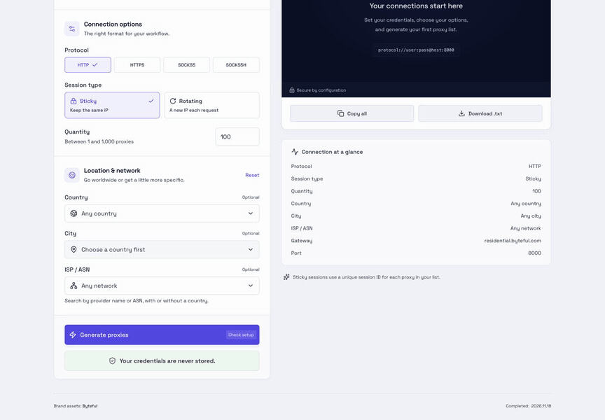
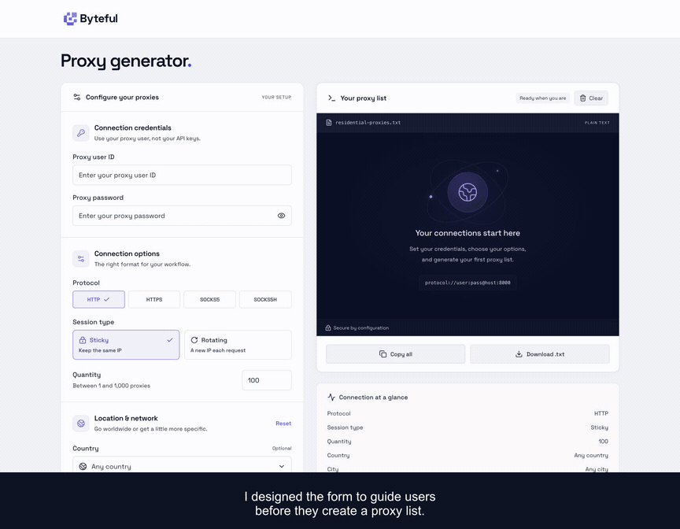

# Byteful Demo

## How to download and watch the videos

The animated GIF previews below show the demos directly in this README. Click a preview or a download link to get the full MP4. GIF previews have no sound; the UX MP4 includes English subtitles and AI narration.

For full-quality playback with audio where available:

1. Click a video link or preview image below to open the MP4 file page.
2. Click **Download raw file** (the download icon). If GitHub shows a **View raw** link instead, open it and use your browser's download or save option.
3. Open the downloaded MP4 file with your video player.

You can also download the full repository using **Code → Download ZIP**, extract it, and open the MP4 files in the `demo` folder.

## 1. Proxy generation walkthrough

[Download the proxy generation video (MP4)](byteful-proxy-demo.mp4) · About 31 seconds · No audio or subtitles

The demo enters the following sample values, selects a location using the live lookup API, and generates five proxy strings locally.

| Setting | Demo value |
| --- | --- |
| Proxy user ID | `customer` |
| Proxy password | `123123` (sample data only) |
| Protocol | HTTP |
| Session type | Sticky |
| Quantity | 5 |
| Country | United Kingdom |
| City | Manchester |

## 2. UX decisions and implementation reasons

[Download the UX video with English narration (MP4)](byteful-ux-demo-subtitled.mp4) · About 46 seconds · English subtitles and AI-generated English narration

The video shows:

- Required-field validation before a generation request, with messages and focus on the missing input.
- Automatic movement to **Your proxy list** and a completion message after successful generation.
- Password masking in the on-screen preview to reduce accidental exposure. Copy and download still include the original password.
- **Connection at a glance** updating with form inputs, followed by **Generated configuration** showing the settings used for the result.

The final password preview is enlarged for clarity. The narration uses a synthetic voice.

Additional files:

- [UX demo without audio](byteful-ux-demo-subtitled-silent.mp4)
- [English subtitles (SRT)](byteful-ux-demo.en.srt)
- [Development process as a separate document](development-process.md)

## Development process

### 1. Understand the task

I first read the assignment to understand its background and purpose.

### 2. Set up the project

I checked the framework, installed the packages, and set up the API keys.

### 3. Review the requirements

I made a checklist of the required features and API rules.

### 4. Build the first version

I used Codex and Stitch to explore different designs. After comparing them, I chose the Codex design and continued with it.

### 5. Check the features

I tested each feature to make sure it worked as expected.

### 6. Review the code

I checked error handling, reusable components, hard-coded values, code quality, and support for future features.

### 7. Improve the UI and UX

My first refactoring focused on clear validation messages, feedback after generation, and password masking.

### 8. Improve the project structure

My second refactoring separated the page, form sections, shared components, and domain API functions.

### 9. Review performance

My third review focused on caching. I considered how to reduce requests while keeping the data fresh enough.

### 10. Update the README

I documented the setup steps, environment variables, assumptions, API errors, and project structure.

### 11. Run the final checks

Finally, I reviewed the tests and ran the full test suite, TypeScript checks, and production build.
